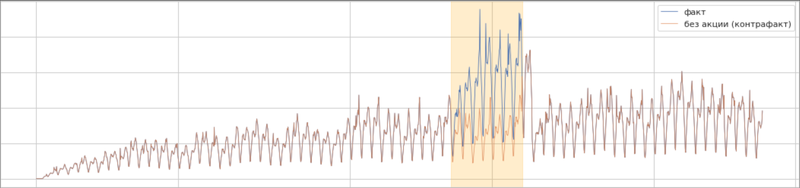
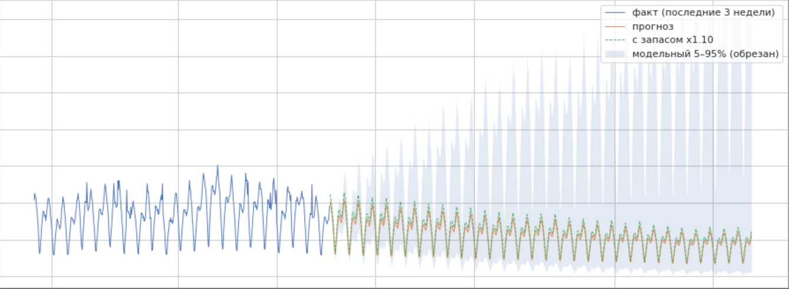
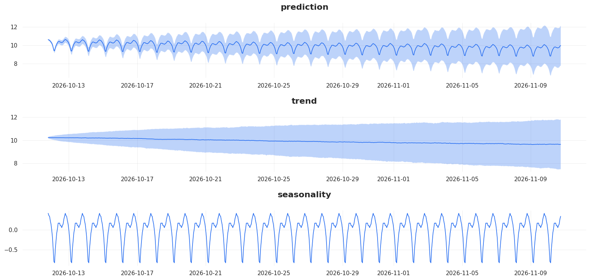

# Прогноз нагрузки на приложение (Orbit DLT)


Прогноз активности пользователей на месяц вперёд для планирования мощности серверов: выбор метрики, учёт аномальной недели акции, бэктестинг с честной оценкой того, на какой горизонт данных хватает, сравнение с простыми baseline'ами и сценарии нагрузки для инженеров.

> Учебный проект выполнен в рамках курса «Симулятор Аналитика» ([ООО «Карпов Курсы»](https://karpov.courses)). Данные и параметры доступа к базе курса в репозитории **не публикуются**.

## Задача

Чем активнее пользователи, тем выше нагрузка на серверы, а жалобы на «подвисания» приложения становятся чаще. Нужно спрогнозировать, как изменится активность в течение ближайшего месяца, и ответить на три вопроса:

1. **Что прогнозировать и как?** Метрика, временное разрешение, регрессоры.
2. **Хватает ли данных для проверки прогноза?** Если нет, то на какой горизонт можно честно проверить модель.
3. **Какую модель выбрать и чему верить?** Интерпретация результатов и ограничения.

## Данные

События ленты новостей (просмотры и лайки) из ClickHouse за **1 августа – 11 октября 2026**, агрегированные до часа: 1 723 часа, 71 полные сутки. Особенности ряда:

- **запуск продукта:** в первые часы всего десятки событий, затем быстрый рост;
- **неделя акции (11–17 сентября):** все метрики вовлечённости резко выросли, потом вернулись к прежнему уровню;
- слабая недельная сезонность и выраженный суточный цикл.

## Ход работы

1. **Метрика и разрешение.** Число событий (просмотры + лайки) в час. Каждое действие в ленте — обращение к серверу, поэтому общее число событий напрямую описывает нагрузку. DAU не подходит (не отражает интенсивность), CTR описывает качество контента, а не нагрузку. Час нужен, потому что серверам важны пиковые часы, а не среднесуточное значение. Прогнозируется `log1p(events)`, чтобы сезонность была мультипликативной.
2. **Акция как аномалия.** Значения за 11–17 сентября заменены контрафактом (тот же час неделей раньше), чтобы модель не принимала скачок за новый уровень. Регрессор `promo` был отвергнут: гибкий уровень модели «съедал» скачок, и коэффициент получался около +5.7% при реальном росте порядка +100%. Эффект акции оценён отдельно (см. ниже).
3. **Регрессоры.** Дни недели (6 бинарных признаков), они известны заранее. Источник, ОС, страна и экспериментальные группы не включены: их будущие значения неизвестны. Праздники не включены: в истории их нет.
4. **Модели.** Orbit DLT с суточной сезонностью (24 часа) и днями недели; вариант с недельной сезонностью (168 часов); затухание тренда 0.8 / 0.9 / 0.95; обучение с 1 августа и с 15 августа (чтобы отсечь запуск продукта). Baseline'ы: среднее по «день недели × час» за всю историю, за последнюю неделю и за две недели.
5. **Бэктестинг.** Скользящий (rolling origin), расширяющееся окно, минимальное обучение 28 дней, шаг 7 дней, горизонты 7, 14 и 23 дня. Фолды, в которых тест пересекается с акцией, исключены, для выбора модели используются только фолды после акции. Метрики: WAPE и ошибка в пиковых часах (верхние 5% по факту), потому что занижение пика для нагрузки опаснее всего.
6. **Финальная модель и сценарии.** Модель обучена на всех данных (MCMC), построен прогноз на 30 дней, а верхняя граница для инженеров откалибрована по ошибкам бэктестинга.

## Хватает ли данных для бэктестинга

Для горизонта 30 дней **нет**. Нужно минимум 28 дней обучения и 30 дней чистого теста, а данных около 71,5 дня; к тому же акция посередине ряда исключает все пересекающиеся окна. После акции остаётся чистое окно около 23,5 дня. Поэтому честно проверены горизонты:

| Горизонт | Фолдов (после акции) |
|---|---|
| 7 дней | 3 |
| 14 дней | 2 |
| 23 дня | 1 |

Качество на 30 дней проверить нечем, месячный прогноз — экстраполяция.

## Результаты

### Выбор модели

Среднее по фолдам после акции (6 фолдов, горизонты 7, 14, 23 дня):

| Модель | WAPE | WAPE в пиковые часы | Смещение на пиках |
|---|---|---|---|
| Baseline: среднее за 2 недели | 0.207 | 0.292 | −26% |
| Baseline: прошлая неделя | 0.214 | 0.319 | −23% |
| Baseline: среднее за всю историю | 0.394 | 0.496 | −49% |
| **DLT, сутки + дни недели, затухание 0.8, обучение с 15.08** | **0.182** | **0.173** | **−9%** |
| DLT, затухание 0.9, обучение с 15.08 | 0.192 | 0.176 | −9% |
| DLT, затухание 0.9, обучение с 01.08 | 0.198 | 0.161 | −8% |
| DLT, недельная сезонность 168 ч (лучший вариант) | 0.249 | 0.197 | +1% |

Лучшая модель на 12% точнее лучшего baseline по общей ошибке и заметно точнее в пиковых часах. Обучение без первых двух недель (с 15 августа) оказалось лучше обучения с запуска продукта.

По горизонтам (WAPE, модель / лучший baseline): 7 дней 0.222 / 0.172, 14 дней 0.189 / 0.198, 23 дня 0.136 / 0.252. На коротком горизонте простой сезонный профиль точнее, на длинном модель выигрывает за счёт дрейфа уровня.

> Выигрыш модели **не доказан статистически**: фолдов всего 6 и они пересекаются по времени, модель лучше baseline только в 3 из 6, а различия между вариантами затухания в пределах шума.

### Что показывает модель

- Главный компонент — **суточный цикл**: ночной провал и вечерний пик около 19–21 часа.
- **Недельный цикл слабый:** эффект дней недели относительно понедельника от −1.7% до −3.8%, статистически значимы только пятница (−3.8%) и воскресенье (−3.5%).
- **Эффект акции** относительно контрафакта: около **+98% по сумме событий и +103% в пиковый час** (оценка снизу: рост аудитории за неделю не учтён). Максимум нагрузки во время акции — 95.6 тыс. событий в час (около 26.6 событий в секунду).
- **Тренд модели нельзя принимать за прогноз.** Он падает примерно на 40% за месяц, а факт последних трёх недель плоский: среднее первых 7 дней прогноза (27.0 тыс. событий в час) на 21% ниже среднего последней недели факта (34.2 тыс.). Модельный интервал на 30 дней раздут (P95 до ~189 тыс. событий в час при историческом максимуме 95.6 тыс.), поэтому для планирования он не используется. Верхняя граница `events_capacity` считается как прогноз × эмпирический коэффициент ×1.10 из бэктестинга, но она тоже ниже уже наблюдавшихся максимумов, поэтому ориентироваться стоит на сценарии ниже.

### Сценарии нагрузки на 30 дней

Вместо одной кривой три сценария по пику событий в час:

| Сценарий | Пик, событий/час | Пик, событий/с |
|---|---|---|
| Модель, тренд вниз | 41.6 тыс. | 11.5 |
| Как последние 2 недели | 53.3 тыс. | 14.8 |
| Акция повторится | 105.4 тыс. | 29.3 |

Справочные значения по факту: типичный пик (P95 за последние 3 недели) 50.2 тыс./час (13.9/с), максимум без акции 72.6 тыс./час (20.2/с), максимум во время акции 95.6 тыс./час (26.6/с).

**Рекомендации для DevOps:**

- базовое планирование: сценарий «как сейчас» (около 53 тыс./час) с запасом до исторического максимума без акции (около 73 тыс./час, ~20 событий/с);
- стресс-сценарий: повторение акции, ориентир около 105 тыс./час (~29 событий/с);
- прогноз нужно пересчитывать еженедельно, надёжный горизонт 1–2 недели.

  

## Ограничения

- **30-дневный прогноз не проверен** бэктестингом: честно подтверждены горизонты 7, 14 и 23 дня.
- Данных около 10 недель, начало ряда — запуск продукта, годовой сезонности и праздников не видно.
- Преимущество модели над baseline невелико и держится на малом числе фолдов.
- Акция непредсказуема: прогноз «нормального» поведения её не покрывает, для неё отдельный сценарий. Контрафакт для недели акции — грубая оценка.
- Не учтены рекламные закупки, A/B-тесты и часовые пояса аудитории.
- События в час — не то же самое, что запросы к серверам по эндпоинтам, для точных расчётов нужен коэффициент перехода от инженеров.

## Что можно улучшить

- Добавить праздники и внешние события, когда по ним накопится история.
- Прогнозировать по сегментам (ОС, источник) и по продуктам (лента, мессенджер).
- Сравнить с другими моделями (Prophet, градиентный бустинг на лагах) на тех же фолдах.
- Оценивать неопределённость не по MCMC-интервалу, а по эмпирическим ошибкам бэктестинга для каждого горизонта.
- Автоматизировать еженедельный пересчёт прогноза (см. проект с Airflow).

## Структура репозитория

```
load-forecasting-orbit/
├── README.md
├── notebooks/
│   └── forecast_activity.ipynb
└── images/       — графики для README
```

## Технологии

Python (pandas, numpy, matplotlib, seaborn) · Orbit (`orbit-ml`, DLT) · ClickHouse (`pandahouse`) · Jupyter.

## Как повторить

1. Установите зависимости: `pip install pandas numpy matplotlib seaborn pandahouse orbit-ml`.
2. В ноутбуке задайте параметры подключения к своей базе ClickHouse (в репозитории доступа к базе курса нет) и выполните запрос выгрузки из `sql/`: число событий (просмотры + лайки) по часам.
3. Запустите ноутбук целиком (Run All). Бэктестинг и обучение финальной модели занимают несколько минут; для быстрой проверки поставьте `USE_MCMC_FOR_FINAL = False`.

## Авторство

Автор: Дарина Радвилович · [GitHub](https://github.com/ddanwit)

Учебный проект выполнен в рамках курса «Симулятор Аналитика», ООО «Карпов Курсы», <https://karpov.courses>. Условия учебных заданий принадлежат ООО «Карпов Курсы» и использованы с указанием авторства. Данные учебной базы и информация о доступе к ней в репозиторий не включены.
